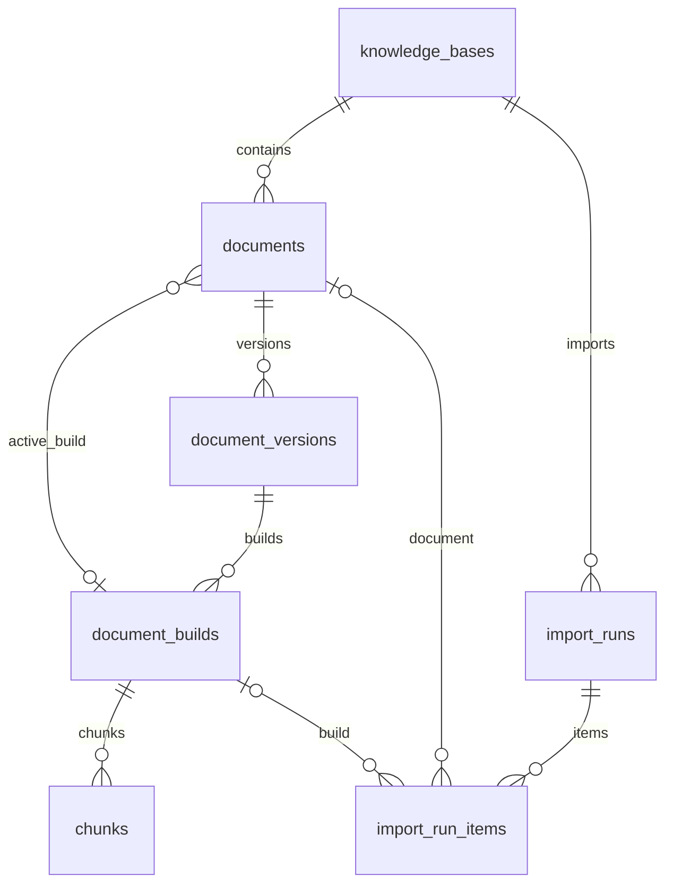

# MySQL 知识库管理：第一阶段

本阶段增加知识库与文档管理，不调用 MinerU、Embedding 或 LLM。Python 运行在 `conda rag`，MySQL 运行在 Docker Compose 中；现有解析、评测入口不依赖数据库。

## 部署与初始化

```powershell
conda activate rag
python -m pip install -r requirements-management.txt

# 新环境：复制后填写两个不同的强密码。已有 .env.mysql 时保留它。
if (-not (Test-Path .env.mysql)) { Copy-Item .env.mysql.example .env.mysql }
# 编辑 .env.mysql 中 MYSQL_PASSWORD 和 MYSQL_ROOT_PASSWORD
docker compose --env-file .env.mysql up -d --wait
python -m rag.manage db upgrade
python -m rag.manage db check
```

Compose 锁定经过验证的 MySQL 8.4 镜像摘要，命名卷为 `rag_mysql_data`，默认端口为 `127.0.0.1:3306`。健康检查会使用应用账号查询初始化数据库。容器重建保留数据；`docker compose down -v` 会删除数据卷，不用于日常重启。

配置文件 `.env.mysql` 已被忽略，独立于原 `.env`；环境变量优先于文件值。`--env-file` 放在 CLI 子命令之前。连接串通过 SQLAlchemy URL 对象构造，密码含特殊字符时不需要手动 URL 转义。数据库账号只具备目标数据库权限；迁移使用该账号的 DDL 权限，不使用 root 运行应用。连接采用 `utf8mb4`、UTC 和严格 SQL 模式。

容器环境变量只在空数据卷首次初始化时创建账号与数据库。已有数据卷上修改配置文件不会自动改密码或建表；密码变更需要同步修改数据库账号，表结构升级统一执行 Alembic 迁移。

```powershell
# 与 db upgrade 等价的标准 Alembic 入口
python -m alembic upgrade head
# 离线输出表结构 SQL，无需数据库或密码
python -m rag.manage db ddl
```

当前迁移版本为 `0003_processing_tasks`，新增原文件处理任务及尝试表，见 [处理任务说明](processing_tasks.md)。第二版 `0002_import_run_items` 新增明细表、`import_runs.error_code` 和 `result_storage`；旧版历史结果在线分批回填，并保留原 `results_json` 存档及汇总。离线 SQL 只描述表结构，历史数据回填必须通过在线 Alembic 升级，不能用离线 SQL 替代已有数据库升级。

升级前暂停管理操作并备份数据库与文件。`result_storage=legacy` 标记历史 JSON 记录，`items` 标记新版记录；新版记录即使在处理前失败，也会阻止直接降级删除明细结构。此时使用升级前备份回滚。历史记录的回填可幂等重试；首版迁移保持不变。

## 核心数据模型



| 表 | 职责与唯一约束 |
|---|---|
| `knowledge_bases` | 知识库信息；`code` 区分大小写且唯一 |
| `documents` | 稳定文档身份与当前处理版本；`(knowledge_base_id, source_key)` 唯一 |
| `document_versions` | 不可变原文件版本；`(document_id, source_sha256)` 唯一 |
| `document_builds` | 不可变处理结果，保存完整文档 JSON 与来源配置；`(document_version_id, output_fingerprint)` 唯一 |
| `chunks` | 切块正文、embedding 输入、检索标记和完整 JSON；同一 build 内原 ID 与位置分别唯一 |
| `import_runs` | 导入起止时间、状态、固定大小汇总和错误码；旧结果 JSON 仅作存档 |
| `import_run_items` | 单文档结果、文档/处理版本映射；`(import_run_id, ordinal)` 唯一，按导入、结果状态和序号索引 |

所有业务主外键采用 `BIGINT UNSIGNED`；哈希为 ASCII `CHAR(64)`、二进制排序；正文为 `LONGTEXT`；时间为 UTC `DATETIME(6)`。表使用 InnoDB、utf8mb4，关系通过外键约束。管理状态为 `active / disabled / archived`，处理版本为 `ready / failed / empty`，导入状态为 `running / succeeded / partial_failed / failed`，均有数据库 CHECK 约束。没有租户字段和用户表。

导入明细状态为 `imported / reused / failed`，失败明细允许文档和处理版本外键为空。成功或复用明细、文档写入与汇总计数在同一个事务内提交；该事务失败后，失败明细通过独立事务保存。不会先提交文档，再单独补写成功日志。

相对路径统一为 Unicode NFC、正斜杠并消除 `.` 与重复分隔符；拒绝绝对路径、`..`、盘符和越出根目录的符号链接。路径大小写保留。`source_key` 为规范化相对路径的 SHA256；相同路径内容更新生成新原文件版本，路径变化视为新文档。

现有 `doc_id` 和 `chunk_id` 只作为来源 ID 保存，不充当全局主键。原文件版本与处理版本分离，重切块不生成新原文件版本。处理版本指纹包含完整原文档记录与按 `chunk_index` 排序的完整切块记录。相同输出复用已有 build，不修改历史 JSON。

切块 `payload_json` 保留全部字段，包括 `sources / context_sources / derived_sources / heading_path / asset_refs`。旧快照没有 `structure_type` 时，用 `content_type`，两者均缺失时用 `body` 填充筛选列，原始 JSON 不补写字段。快照没有记录的解析、模型或切块参数明确标记为未知。

`active_build_id` 的存在性由外键检查，归属由服务在事务中校验并锁定文档。只有 `ready`、非空、切块数量完整的版本可以启用。多个文档的批量启用在一个事务中完成；任意目标不合法，全部回滚。停用和归档保留当前指针与历史记录。

## 导入与管理命令

```powershell
python -m rag.manage kb create --code default --name "默认知识库"
python -m rag.manage kb list

# 以下 ID 使用上一步实际返回的值；新数据库通常为 1。
python -m rag.manage corpus import --kb-id 1 --source data/benchmark/gold150_hard_v2
python -m rag.manage import show --import-id 1
python -m rag.manage import show --import-id 1 --limit 10 --offset 10
python -m rag.manage import items --import-id 1 --status failed --limit 100

# 导入默认不启用，显式切换后成为当前版本。
python -m rag.manage import activate --import-id 1
python -m rag.manage document list --kb-id 1
python -m rag.manage document show --document-id 1
python -m rag.manage document versions --document-id 1
python -m rag.manage document builds --document-id 1

python -m rag.manage chunk list --document-id 1 --eligible-only --limit 100
python -m rag.manage chunk show --chunk-id 1
# 明确指定 build 可检查历史或停用文档的切块。
python -m rag.manage chunk list --build-id 1

python -m rag.manage document activate --document-id 1 --build-id 1
python -m rag.manage document status --document-id 1 --status disabled
python -m rag.manage document status --document-id 1 --status active
python -m rag.manage kb update --kb-id 1 --name "默认知识库" --description "政策与技术语料"
python -m rag.manage kb status --kb-id 1 --status archived
```

`document activate` 同时用于启用新版本和回滚历史版本。首期不提供物理删除。列表支持 `--limit`（1–1000）与 `--offset`；知识库、文档列表可按 `--status` 筛选。未指定 build 的切块查询要求知识库、文档均启用且有当前版本；管理列表与指定历史 build 的查询保留审计能力。

CLI 输出 UTF-8 JSON。成功退出码为 0；参数错误由 argparse 返回 2；操作失败、导入失败或部分失败返回 1。操作异常输出 `error_code` 和固定的 `error` 消息；数据库异常只附加数值数据库错误码，文件系统异常只附加数值 errno。其它非受控异常不回显原文、路径、连接串、SQL 参数或 traceback。受控业务异常从固定消息目录生成，校验错误不拼接输入值。管理元数据中的 `source_uri/storage_uri` 仍可正常查询。

历史错误文本留在旧 JSON 中供兼容存档；迁移出的失败明细及历史导入查询只显示 `LEGACY_ERROR` 和固定提示。当前查询不加载旧累计结果数组。

`corpus import` 和 `import show` 保留 `results_json` 返回键，它现在是明细表的当前页，默认 100 条；`results_page` 给出 `total/limit/offset`。`import items` 返回 `total/limit/offset/items`，可按明细状态过滤。分页总数是结果数量；批量启用始终使用全部成功映射，不受查询分页限制。服务层对资源和状态执行白名单校验：知识库、文档、处理版本和导入分别使用自己的状态集合，原文件版本与切块拒绝状态过滤。

导入要求 `documents.jsonl / chunks.jsonl`，以及声明两份文件 SHA256 的 `manifest.json` 或 `report.json`。校验 ID、文档关联、路径、切块位置与数量、检索布尔标记、物理来源区间。默认原文件根目录为 `data/raw`，可通过 `--raw-root` 指定其他根目录。

校验后的原始字节保存至 `RAG_STORAGE_ROOT/snapshots/<fingerprint>/`，原文件保存至 `RAG_STORAGE_ROOT/raw/<sha256>`，默认根目录是 `data/storage`。发布前先暂存与校验，重复导入也检查原文件及现有存储副本，拒绝覆盖损坏的不可变文件。明确记录的本地解析目录及资产会复制并校验；无法定位且未声明哈希的资产引用记录在 `missing_asset_refs`，不会假装拥有完整解析缓存。

结构或快照哈希错误会使整次导入失败；原文件或数据库写入错误按文档隔离，成功文档保留，失败文档整笔事务回滚。每篇只追加一条结果并更新固定大小计数，不再重写累计结果 JSON。`summary_json.documents` 是已校验语料的总文档数，`imported + reused + failed` 是已提交结果数；另有切块总数和可检索切块数。修复后重新执行导入即可重试，已完成的版本复用；进程被强制终止可能留下 `running` 记录，已提交明细和进度仍可查询，不阻塞重新导入。部分失败的导入不能批量启用，可单独检查并启用成功版本。

单次导入按文档顺序执行。同一 KB 的单文档事务通过 KB 行锁互斥，锁随该文档事务提交释放；两个并发导入允许在文档之间交错，不保证整次导入串行。文件准备在文档事务之外，重复发布仍须通过不可变文件哈希校验。

默认知识库接收 33 份现有文档：政策 19 份、技术 14 份，共 1,390 个切块，其中 1,308 个允许检索。既有评测快照保持原位置和原始字节，不从 MySQL 重新序列化覆盖，也不修改既有向量索引。

## 备份与恢复

备份时暂停管理写入、数据库迁移、存储清理及手工文件修改，确保数据库与本地文件处于同一状态。当前已发布文件只追加、不覆盖、不删除；先 dump 数据库、后复制文件时，文件副本允许包含数据库快照未引用的额外文件。未来引入物理删除或清理前，必须让这些操作与备份使用共同协调机制。

`backup.json.consistency_contract` 记录这些约定，并明确 `coordination_enforced=false`：脚本没有自动获得维护锁，也没有通过 storage epoch 声称可以约束外部修改。脚本使用二进制流保存 SQL，避免 Windows PowerShell 重定向改变编码；备份包含数据库、完整本地存储副本和逐文件 SHA256，不包含密码文件。

```powershell
python scripts/backup_knowledge_base.py backup --output tmp/mysql_backup_20261013

# 恢复到不存在的隔离数据库及新目录，不覆盖原库。
python scripts/backup_knowledge_base.py restore --input tmp/mysql_backup_20261013 `
  --database rag_restore_20261013 --storage-root tmp/mysql_restore_20261013
```

恢复先验证备份哈希，创建隔离数据库并授予应用账号权限，导入 SQL、复制文件，再将恢复库中的原文件与处理资产路径指向新存储根目录。原库、原存储不变。恢复后设置 `MYSQL_DATABASE` 与 `RAG_STORAGE_ROOT` 指向恢复目标，再执行 `db check` 和管理查询验收。备份需放到独立磁盘或备份介质；数据库卷本身不是备份。

## 测试与后续阶段

```powershell
python -m unittest discover -s tests -v

# opt-in：真实 MySQL，自动创建 rag_test_<随机值> 并在结束后删除。
$env:RAG_RUN_MYSQL_TESTS="1"
python -m unittest discover -s tests -p test_management_mysql.py -v
Remove-Item Env:RAG_RUN_MYSQL_TESTS
```

集成测试使用当前 Compose 的应用账号，测试库权限由容器内 root 初始化。覆盖完整语料与原始 JSON、重复/并发导入、文件和数据库失败、版本生成、切换回滚、跨文档拒绝、批量原子性、启停、CLI 和迁移升降级。不使用 SQLite，也不运行模型推理。

MySQL 当前版本已接入可重建 Elasticsearch 索引，提供显式同步、alias 发布/回滚、当前状态过滤及检索对照，见 [管理检索说明](managed_search.md)；原文件注册、解析切块及持久化失败重试见 [处理任务说明](processing_tasks.md)。原 NumPy 入口保留为 release 评测基线。后续接入自动索引同步、HTTP API/管理页面，再补 CI、监控及周期备份。policy/technical 拆库、对象存储和多租户根据实际需求另行选择。

## 首轮实施验收（2026-10-13）

| 验收项 | 结果 |
|---|---|
| Docker 与迁移 | MySQL 8.4.11 健康运行；六张业务表，迁移版本 `0001_kb_management` |
| 默认知识库 | ID `1`、code `default`；33 份文档、33 个原文件版本、33 个处理版本、1,390 个切块 |
| 检索标记与分类 | 1,308 个可检索切块；政策 19 份、技术 14 份 |
| 首次与重复导入 | 导入记录 `1` 创建 33 个版本；记录 `2` 全部复用，数量不变 |
| 当前版本 | 33 个处理版本通过显式批量操作启用 |
| 原始数据 | 既有快照哈希保持不变，完整 JSON 与来源 ID 保留 |
| 容器重建 | 强制重建容器后，文档、切块与当前指针全部保留 |
| 备份恢复 | 恢复至隔离库 `rag_restore_phase1_20261013`；数量与当前指针一致，原文件和快照逐文件哈希通过 |
| 测试 | 140 项常规测试通过；10 项真实 MySQL 集成测试单独运行通过 |

本地凭据在被忽略的 `.env.mysql`，运行明细在 `tmp/mysql_phase1_verification.json`。验收备份在 `tmp/mysql_phase1_backup_20261013`，恢复文件在 `tmp/mysql_phase1_restore_20261013`。这些目录都被 Git 忽略，备份后续应转移到独立备份介质。产物清理按 `clean-artifacts` 做 dry-run，仅记录候选，不执行删除。

## 审查修正验收（2026-10-13）

| 验收项 | 结果 |
|---|---|
| 迁移与兼容 | 当前库升级到 `0002_import_run_items`，七张业务表；两次历史导入回填 66 条明细，旧 JSON 保持不变 |
| 新版导入 | 记录 `3` 全部复用现有 33 份文档，新增 33 条明细，旧结果数组为空；切块仍为 1,390 个，其中 1,308 个可检索 |
| 分页与启用 | 按状态分页返回指定范围；历史记录批量启用保持 33 个当前版本 |
| 千篇合成语料 | 1,000 条明细逐条写入；汇总更新小于 256 字节，无累计数组重写；默认页返回 100 条，全部 1,000 份文档可启用 |
| 事务与中断 | 成功日志失败则文档、版本、切块与计数共同回滚；进程中断保留已提交明细和进度 |
| 历史与错误边界 | 成功、部分失败和未完成历史记录回填、重试及旧 JSON 保留通过；密码、连接串、SQL 参数和绝对路径注入测试通过 |
| 测试 | 146 项常规单元测试通过，17 项真实 MySQL 集成测试单独运行通过 |
| 备份恢复 | 恢复库 `rag_restore_import_items_20261013` 的 99 条明细、全部版本与当前指针一致；恢复文件逐项哈希通过 |

升级前备份在 `tmp/mysql_before_import_items_20261013`；新版备份在 `tmp/mysql_import_items_backup_20261013`，恢复文件在 `tmp/mysql_import_items_restore_20261013`。运行验收明细在 `tmp/import_items_verification.json`。备份清单明确记录人工暂停及只追加文件的约束，没有自动维护锁；生产规模的流式语料读取、存储清理协调和任务队列仍属于后续阶段。
